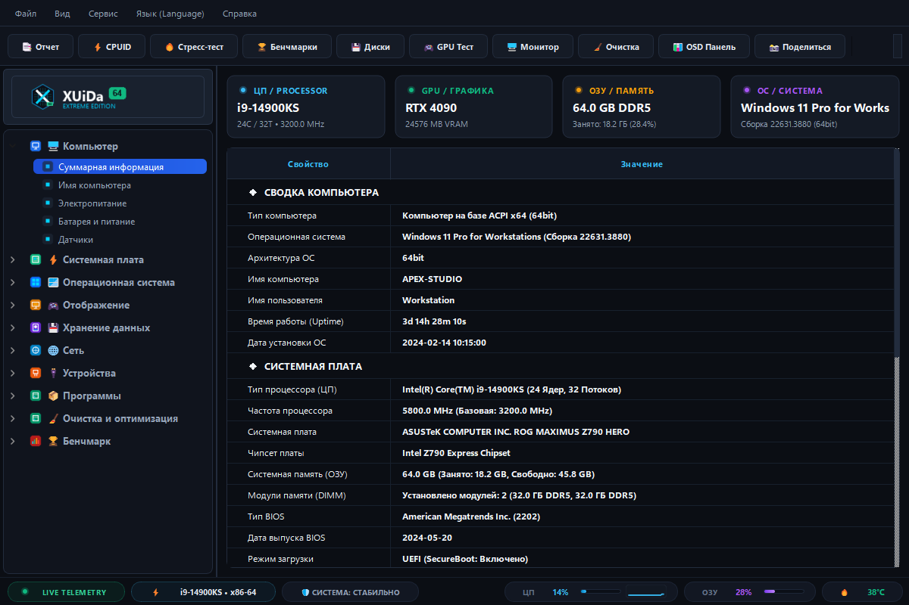
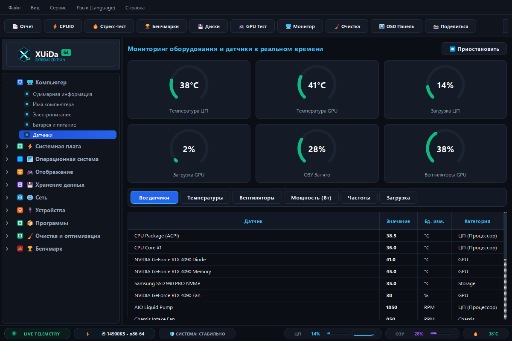
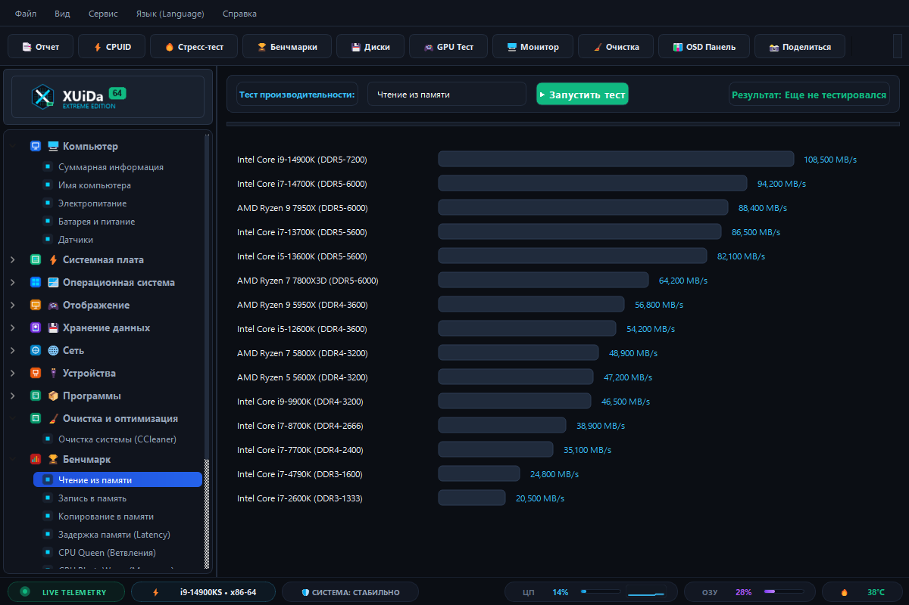
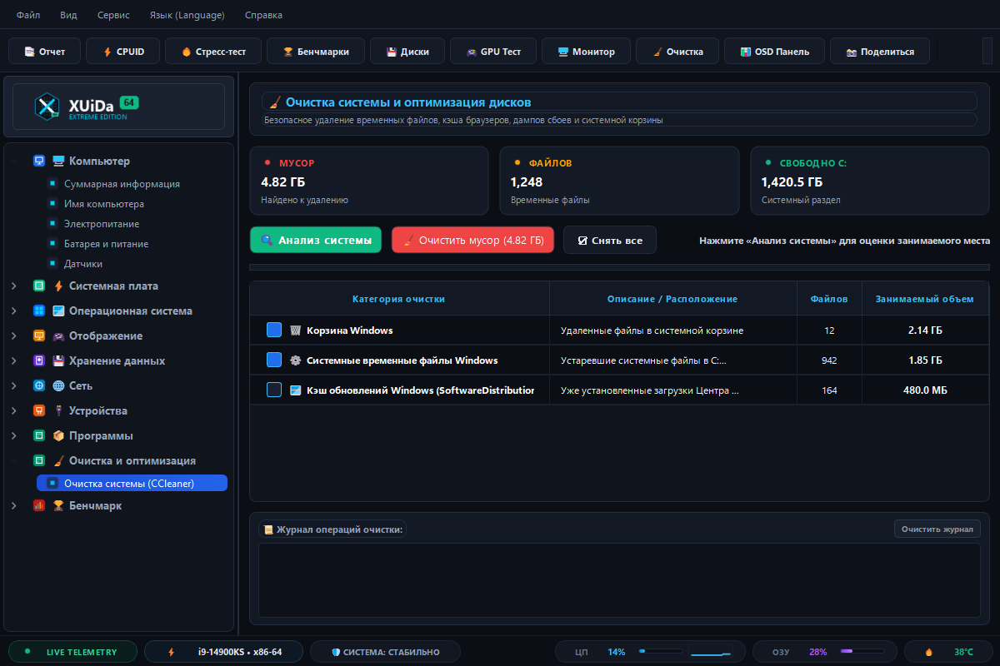
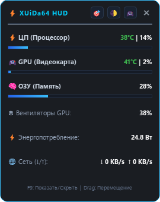
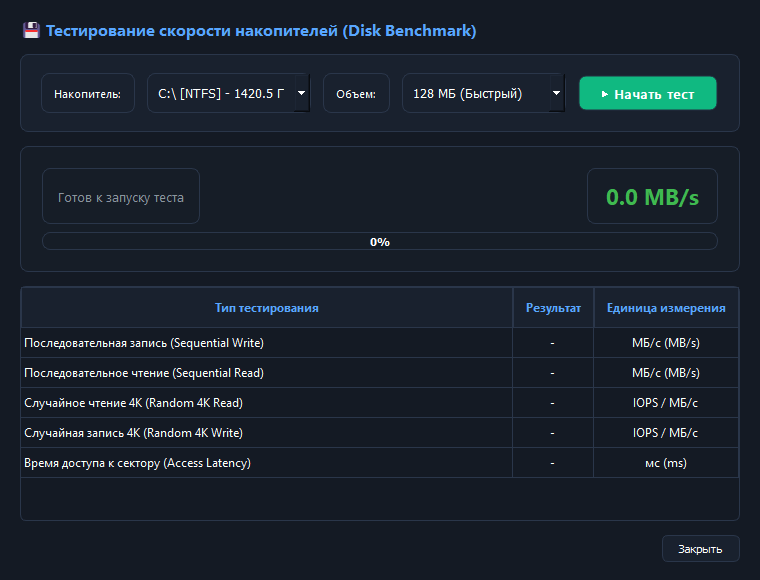
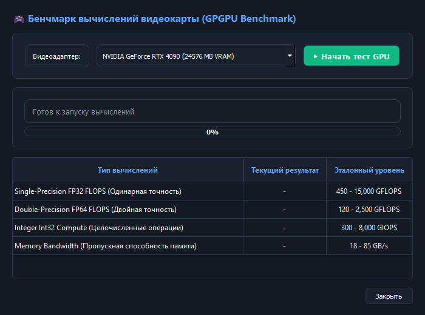
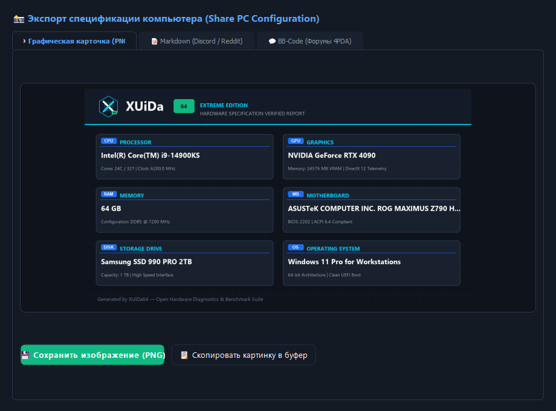

<div align="center">


# ⚡ XUiDa64 Extreme Edition

**Современный, высокопроизводительный и 100% открытый комплекс аппаратной диагностики и мониторинга ПК для Windows.**

[](https://opensource.org/licenses/MIT)
[](https://python.org)
[](https://microsoft.com/windows)
[](https://riverbankcomputing.com/software/pyqt/)
[](https://github.com/nmazarov/XUiDa/actions)

*Без платных лицензий. Без триальных ограничений. Без закрытых системных драйверов. 100% Free & Open Source.*

[Русское описание](#русское-описание) | [Скриншоты](#скриншоты-интерфейса) | [English Description](#english-description)

</div>

---

## 📸 Скриншоты интерфейса

<div align="center">

### Сводная информация о системе (Summary View)
*Глубокий анализ процессора, видеокарты, памяти, системной платы и BIOS в едином обсидиановом интерфейсе.*
<br/>


<br/><br/>

| 📊 Мониторинг датчиков в реальном времени | 🏆 Сравнительные бенчмарки CPU и памяти |
| :---: | :---: |
| *Круговые шкалы температур, загрузки и частот* | *Многопоточные тесты с эталонной базой* |
|  |  |

<br/>

| 🧹 Очистка и оптимизация дисков | ⚡ Игровой HUD-оверлей датчиков (F9) |
| :---: | :---: |
| *Безопасное удаление кэша и временных файлов* | *Компактный плавающий виджет поверх окон* |
|  |  |

<br/>

| 💾 Тест накопителей (Disk Benchmark) | 🎮 Вычисления GPGPU (GPU Compute) |
| :---: | :---: |
| *Скорость линейного чтения/записи и 4K IOPS* | *Вычисления одинарной и двойной точности FLOPS* |
|  |  |

<br/>

### 📸 Экспорт верифицированной киберпанк-карточки ПК (Share PC Card)
*Генерация стильной графической карточки конфигурации 16:9 для соцсетей, а также готовый Markdown и BB-Code.*
<br/>


</div>

---

<a name="русское-описание"></a>
## 🇷🇺 Русское описание

**XUiDa64 Extreme Edition** — это мощный диагностический комплекс для глубокого анализа аппаратного обеспечения, стресс-тестирования стабильности системы, мониторинга температур в системном трее, проверки монитора на битые пиксели, тестирования скорости SSD/дисков и проведения всесторонних бенчмарков памяти, процессора и видеокарты.

Проект создан как современный, открытый, быстрый и абсолютно бесплатный инструмент, доступный каждому энтузиасту, оверклокеру, геймеру и системному администратору.

---

### 🆚 Сравнение возможностей

| Возможность | ⚡ XUiDa64 Extreme | 💰 Коммерческие пакеты | 🔹 CPU-Z | 🔸 HWiNFO64 |
| :--- | :---: | :---: | :---: | :---: |
| **Стоимость** | **Бесплатно (MIT)** | ~$40–60 / год | Бесплатно | Условно-бесплатно |
| **Открытый исходный код** | **✅ Да (GitHub)** | ❌ Нет (Закрытый) | ❌ Нет | ❌ Нет |
| **Прямое исполнение CPUID (ASM x86-64)** | **✅ Да** | ✅ Да | ✅ Да | ✅ Да |
| **Стресс-тест стабильности (FPU/RAM)** | **✅ Да (pyqtgraph)** | ✅ Да | ❌ Нет | ❌ Нет |
| **Бенчмарки памяти (Read/Write/Latency)**| **✅ Да (Pointer-chasing)** | ✅ Да | ❌ Нет | ❌ Нет |
| **Тест скорости накопителей (Disk Bench)**| **✅ Да (Seq + 4K IOPS)** | ✅ Да | ❌ Нет | ❌ Нет |
| **Вычисления GPGPU (FP32/FP64 FLOPS)** | **✅ Да** | ✅ Да | ❌ Нет | ❌ Нет |
| **Диагностика монитора (Битые пиксели)**| **✅ Да (Fullscreen)** | ✅ Да | ❌ Нет | ❌ Нет |
| **Мониторинг в трее + Оповещение перегрева**| **✅ Да** | ✅ Да | ❌ Нет | ✅ Да |
| **Экспорт графической карточки ПК (PNG)**| **✅ Да (Cyberpunk Card)** | ❌ Нет | ❌ Нет | ❌ Нет |
| **Степень износа батареи ноутбука (%)** | **✅ Да** | ✅ Да | ❌ Нет | ✅ Да |
| **Интерфейс на нескольких языках** | **✅ RU, EN, DE, ZH** | ✅ Да | ❌ Только EN | ❌ Только EN |

---

### 🌟 Ключевые возможности

| Раздел | Описание |
| :--- | :--- |
| **🖥️ Компьютер (Summary & Tree)** | Складные категории-аккордеон. Полная сводка: ОС, процессор, материнская плата, память, видеокарта, Uptime, BIOS, параметры энергопотребления. |
| **🔋 Батарея и питание ноутбуков** | Расчет процента износа аккумулятора (Battery Wear Level %), паспортная vs реальная емкость, скорость разряда (мВт), расчетное оставшееся время. |
| **⚡ Нативный CPUID x86-64** | Прямое исполнение процессорной инструкции `CPUID` в машинной памяти без сторонних платных драйверов. Частоты, микрокод, кэши L1/L2/L3, флаги MMX, SSE, AVX, AVX2, AVX-512, FMA, AES, SHA, BMI. |
| **💾 Тест дисков (Disk Benchmark)** | Измерение скорости линейной и случайной записи/чтения (Seq Read/Write, 4K Random IOPS, Access Latency ms) для SSD, NVMe, HDD и флешек. |
| **🎮 GPGPU Compute Benchmark** | Вычислительная мощь графического ускорителя: Single-Precision FP32 FLOPS, Double-Precision FP64 FLOPS, Integer IOPS и скорость шины памяти (GB/s). |
| **🖥️ Тест экрана (Monitor Diagnostics)** | Полноэкранный режим проверки матрицы: сплошные заливки для поиска битых/застрявших пикселей, 16-уровневые градиенты серого, RGB-градиенты для выявления Banding, сетка геометрии и тест субпиксельного рендеринга ClearType. |
| **🔔 Системный трей и термозащита** | Фоновый мониторинг в трее Windows рядом с часами. Всплывающее предупреждение (Toast Notification) при перегреве процессора или видеокарты (> 85 °C). |
| **📸 Карточка ПК (Share Config)** | Экспорт стильной графической 16:9 киберпанк-карточки ПК (PNG) для социальных сетей, а также готовый текст в форматах Markdown (Reddit, Discord) и BB-Code (4PDA, Overclockers). |
| **🏆 Комплексный пакет бенчмарков** | Набор тестов с эталонной базой процессоров: <br>• **Memory Read / Write / Copy** (МБ/с)<br>• **Memory Latency** (нативное pointer-chasing в x86-64 коде, нс)<br>• **CPU Queen, PhotoWorxx, ZLib, AES, SHA3**<br>• **FPU Julia, Mandel, SinJulia**. |
| **🔥 Стресс-тест стабильности** | Полнофункциональный **System Stability Test** с интерактивными графиками `pyqtgraph` и детектором термического троттлинга. |
| **📑 Мастер отчетов** | Экспорт подробного диагностического отчета в интерактивный **HTML**, классический текстовый **TXT** или машиночитаемый **JSON**. |

---

### 🚀 Быстрый запуск

#### 1. Клонирование репозитория
```bash
git clone https://github.com/nmazarov/XUiDa.git
cd XUiDa
```

#### 2. Установка зависимостей
```bash
pip install -r requirements.txt
```

#### 3. Запуск приложения
```bash
python app.py
```

---

### 📦 Сборка в один автономный `.exe` файл

В проект включен скрипт автоматической сборки через PyInstaller с оптимизированным размером и вшитой векторной иконкой:

```bash
python build_exe.py
```
После завершения готовый исполняемый файл `XUiDa64.exe`, не требующий установленного Python, будет доступен в:
`dist/XUiDa64/XUiDa64.exe`.

Готовый собранный архив также автоматически компилируется при каждом обновлении в [GitHub Actions](https://github.com/nmazarov/XUiDa/actions).

---

<a name="english-description"></a>
## 🇬🇧 English Description

**XUiDa64 Extreme Edition** is an advanced open-source system diagnostics, benchmarking, hardware monitoring, and stability stress-testing utility for Windows x64.

A modern, high-performance open-source diagnostic and benchmarking suite designed for PC enthusiasts, gamers, overclockers, and system administrators.

### Highlights:
- **Zero Drivers Required**: Uses native x86-64 machine code for direct `CPUID` instruction queries and memory latency pointer-chasing.
- **Hardware Benchmarking Suite**: Tests Memory Read, Write, Copy, Latency, CPU Queen, PhotoWorxx, ZLib, AES, SHA3, and FPU Julia/Mandel with comparative bar charts vs modern reference CPUs.
- **Storage Disk Benchmark**: Measures Sequential & Random 4K IOPS throughput and access latency.
- **GPGPU Compute Benchmark**: Evaluates Single-Precision FP32, Double-Precision FP64, and VRAM memory transfer rate.
- **Monitor Diagnostics**: Full-screen dead pixel locator, grayscale ramps, and color banding tests.
- **Laptop Battery Wear Level**: Analyzes designed capacity vs full capacity and real-time discharge rate.
- **System Tray & Thermal Alerts**: Windows taskbar tray icon with instant warnings when hardware exceeds 85 °C.
- **Share PC Card Generator**: Exports a futuristic 16:9 PC specification graphic image and forum-ready Markdown/BBCode.
- **Multi-Language Support**: Instant switching between Russian, English, German, and Chinese.

---

### 📄 Лицензия

Проект распространяется под свободной лицензией **MIT License**. Свободно для личного и коммерческого использования.